

  

<h3 align="center">🚀 Founder &amp; CEO of PALDYN</h3>

  <b>생각을 멈추지 않고, 무엇이든 실행에 옮깁니다.</b> 
  기술에 갇히지 않고, AI를 지렛대 삼아 필요한 걸 만들어 냅니다.

---

## 🤖 AI-Powered Workflow

  
  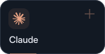
  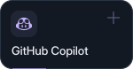
  
  

---

## 🧰 다뤄본 것들

  <b>Language</b> 
  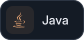
  
  
  
  

  <b>Backend</b> 
  
  
  
  
  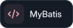

  <b>Database</b> 
  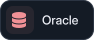
  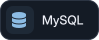
  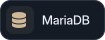
  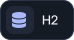

  <b>DevOps</b> 
  
  
  
  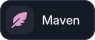
  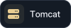

  <b>Collab / OS</b> 
  
  
  
  
  

---

## 📊 GitHub 통계

  

### Contribution Snake

<picture>
  <source media="(prefers-color-scheme: dark)" srcset="./assets/readme-polish/snake-dark.svg" />
  <source media="(prefers-color-scheme: light)" srcset="./assets/readme-polish/snake-light.svg" />
  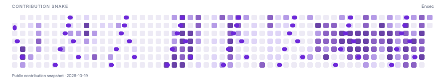
</picture>

---

